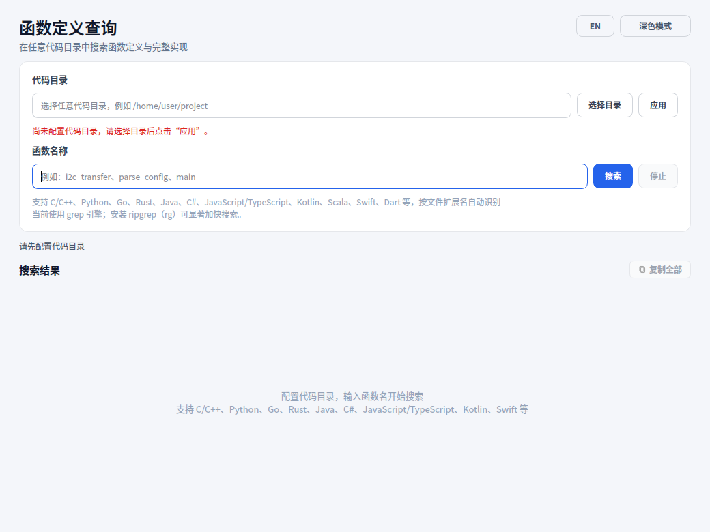

# FuncFinder

**在任意代码目录中快速定位函数、变量、常量与宏的定义。**
**Find function, variable, constant, and macro definitions in any codebase.**

[](https://github.com/zhijian-yan/FuncFinder/actions/workflows/ci.yml)
[](https://github.com/zhijian-yan/FuncFinder/releases)
[](LICENSE)
[](https://www.python.org/)



## 简介

FuncFinder 是一个基于 Python + PySide6/Qt 6 的桌面工具。选择一个代码目录，
在「函数」「变量」或「宏」模式下输入名称，它会搜索定义并把签名、文件位置、
行号和完整代码展示成卡片，适合在大型项目中快速阅读不熟悉的代码。

它不是语言服务器，也不依赖编译器索引；它通过扩展名识别语言，并用启发式规则
提取函数边界、变量声明和宏定义。因此对常见代码足够快，也允许在混合语言目录中
直接使用。

## 功能

- **函数、变量与宏**：三种搜索模式共用同一个代码目录和结果视图，可随时切换。
- **变量定义**：支持全局/局部变量、常量、结构体/类字段、Python
  `self.attr` 实例属性，并标注结果的作用域。
- **宏定义**：支持 C/C++/Objective-C 的 `#define`（对象宏、函数宏和多行宏）、
  C# `#define` 以及 Rust `macro_rules!`，卡片会显示完整宏体。
- **变量作用域配色**：全局、局部、成员、类属性、实例属性和类型成员使用
  不同颜色；卡片左侧强调条、作用域徽标与代码中的变量名保持一致。
- **大小写选项**：「区分大小写」默认开启；关闭后普通名称搜索忽略大小写，
  例如 `max_size` 可以找到 `MAX_SIZE`，结果仍保留源码中的原始拼写。
- **多语言**：C/C++、Python、Go、Rust、Java、C#、JavaScript/TypeScript、
  Kotlin、Scala、Swift、Dart、Objective-C（C 函数/变量部分）。
- **快速搜索**：普通搜索优先使用 `ripgrep`，其次系统 `grep`，最后纯
  Python 扫描；不区分大小写时会直接给 rg/grep 加 `-i`。纯 Python 回退会
  先用名称 token 预筛选，避免在每一行都运行完整的声明候选表达式。
- **引擎状态**：搜索框下方常驻显示当前搜索引擎（ripgrep / grep / Python），
  不会只在搜索过程中出现。
- **后台搜索**：搜索在工作线程执行，界面不卡顿，可随时停止。
- **完整实现**：不仅显示定义行，还会根据花括号/缩进提取整个函数体；
  变量模式会包含多行初始值，宏模式会收集反斜杠续行的完整宏体。
- **语法高亮**：按语言高亮关键字、字符串、注释和数字，并突出显示当前
  函数、变量或宏名。
- **结果排序**：可按默认顺序、名称、文件路径、作用域或语言排序，并用
  ↑/↓ 切换升序或降序。
- **结果筛选**：支持按名称、路径、语言、签名筛选（空格分隔多个关键词），
  也可按函数、宏或变量作用域筛选；结果数会显示“当前显示 / 总数”。
- **结果操作**：单条复制、复制全部、显示文件位置和行号；复制全部只复制
  当前筛选后显示的结果。
- **桌面体验**：浅色/深色主题、中英文切换、窗口/任务栏图标。
- **Linux 集成**：首次运行自动注册 `.desktop` 和 hicolor 图标，Ubuntu Dock
  能正确显示图标；也可手动执行 `--install-desktop`。
- **跨平台打包**：`package.py` 支持 PyInstaller 的 onedir/onefile，
  Linux 和 Windows 均有 GitHub Actions 构建。

## 支持语言

| 语言 | 扩展名示例 |
| --- | --- |
| C / C++ | `.c` `.h` `.cc` `.cpp` `.hpp` `.ino` |
| Objective-C | `.m` `.mm` |
| Python | `.py` `.pyi` |
| Go | `.go` |
| Rust | `.rs` |
| Java | `.java` |
| C# | `.cs` |
| JavaScript / TypeScript | `.js` `.jsx` `.ts` `.tsx` |
| Kotlin | `.kt` `.kts` |
| Scala | `.scala` |
| Swift | `.swift` |
| Dart | `.dart` |

变量模式使用同一套扩展名识别规则，支持：

- C/C++、Objective-C：全局/局部变量、常量、结构体/类字段、静态成员定义。
- Python：模块赋值、`class` 属性、函数局部变量、`self.attr`/`cls.attr`
  实例属性、类型注解和多目标解包。
- JavaScript/TypeScript：`const`/`let`/`var`、类字段、解构赋值。
- Go：`var`/`const`（含分组声明）、`:=` 短声明、结构体字段。
- Rust：`let`、`static`、`const`、结构体字段和 `impl` 中的关联常量。
- Java/C#：字段与局部变量；属性（property）会被排除。
- Kotlin/Scala/Swift/Dart：`val`/`var`/`let`/`final`/`const` 以及字段。

结果卡片会显示变量作用域（全局变量、局部变量、成员变量、类属性、
实例属性等）。变量提取同样是启发式的，赋值和声明会尽量区分，但复杂宏、
隐式声明或动态语言中的重绑定仍可能需要人工确认。

宏模式使用同一套扩展名识别规则，支持：

- C/C++、Objective-C：`#define` 对象宏、函数宏，以及用反斜杠续行的多行宏。
- C#：`#define` 预处理符号。
- Rust：`macro_rules!` 声明式宏。

宏模式只查找宏定义，不展开宏调用点；多行宏按反斜杠续行收集完整主体。

## 快速开始

要求：Python 3.10+。源码运行支持 Linux/Windows/macOS；打包脚本目前支持
Linux/Windows。

```bash
git clone https://github.com/zhijian-yan/FuncFinder.git
cd FuncFinder
python3 -m venv .venv
source .venv/bin/activate          # Windows: .venv\Scripts\activate
pip install -r requirements.txt
python func_finder.py
```

### 安装 ripgrep（推荐）

`ripgrep` 可以显著加快大目录的搜索速度：

```bash
# Ubuntu / Debian
sudo apt install ripgrep

# macOS (Homebrew)
brew install ripgrep

# Windows (winget)
winget install BurntSushi.ripgrep.MSVC
```

没有 `rg` 时会自动回退到 `grep`，再回退到纯 Python 扫描。可以用环境变量强制
指定后端：

```bash
FUNC_FINDER_BACKEND=rg python func_finder.py
FUNC_FINDER_BACKEND=grep python func_finder.py
FUNC_FINDER_BACKEND=python python func_finder.py
```

## 使用

1. 启动程序，点击「选择目录」指定代码目录。
2. 在搜索框上方选择「函数」「变量」或「宏」。
3. 输入名称，例如函数 `i2c_transfer`、`parse_config`、`main`，
   变量 `MAX_BUFFER_SIZE`、`config`、`timeout`，或宏 `MIN`、`I2C_TRANSFER`。
4. 搜索框右侧的「区分大小写」默认开启；关闭后会忽略大小写，例如
   `max_size` 可以找到 `MAX_SIZE`。
5. 点击「搜索」，结果会以卡片形式显示。
6. 结果上方可输入筛选词（名称、路径、语言或签名，空格分隔多个关键词），
   选择函数、宏或具体作用域，并通过排序下拉框选择排序依据、用 ↑/↓ 切换方向。
7. 使用卡片上的复制按钮复制完整实现、变量定义或宏定义，或点击「复制全部」；
   复制全部只包含当前筛选后显示的结果。
8. 右上角可以切换主题和语言；搜索模式、主题、大小写和排序等配置会自动
   保存，筛选条件会在下一次搜索时重置。

名称可以包含字母、数字、下划线、`$`，且不能以数字开头，并按完整名称
匹配：`config` 不会命中 `config_loader`。「区分大小写」默认开启，关闭后
匹配时忽略大小写，但结果仍保留源码中的原始拼写。变量模式会搜索文件中的
声明和定义，宏模式只搜索宏定义；卡片中的路径标签可悬停查看完整路径。搜索框
下方的「引擎：…」小字会一直显示当前搜索引擎。

> 提示：切换「函数」/「变量」/「宏」只影响下一次搜索；已经显示的结果卡片会
> 保留自己的类型和标签。搜索进行中模式与选项按钮会暂时禁用，点击「停止」后
> 可切换。

## 命令行

```bash
python func_finder.py --version
python func_finder.py --install-desktop     # Linux：注册桌面入口和图标
python func_finder.py --uninstall-desktop   # Linux：删除桌面入口和图标
```

Linux 桌面入口写入当前用户目录，不需要 `sudo`：

```text
~/.local/share/applications/func-finder.desktop
~/.local/share/icons/hicolor/512x512/apps/func-finder.png
~/.local/share/icons/hicolor/192x192/apps/func-finder.png
```

如果不想在启动时自动注册，可以设置：

```bash
FUNC_FINDER_NO_DESKTOP_ENTRY=1 ./FuncFinder
```

配置位置：Linux 下为 `~/.config/FuncFinder/FuncFinder.conf`，Windows 下由
Qt `QSettings` 保存到注册表。

## 打包

打包使用 [PyInstaller](https://pyinstaller.org/)。`package.py` 会自动创建
构建虚拟环境、安装依赖，并把 `assets/` 和 ripgrep 一并放进产物。

```bash
# Linux：单文件 + tar.gz 分发包（在 Ubuntu 22.04 上执行）
python3 package.py --target linux --onefile --archive

# 在 Ubuntu 24.04/26.04 等新系统上构建兼容包（需要 Docker）
python3 package.py --target linux --docker --onefile --archive

# Windows：单文件 + zip 分发包
python package.py --target windows --onefile --archive
```

不加 `--onefile` 时默认生成 onedir 目录（启动更快，但必须分发整个目录）。
PyInstaller 不支持跨系统编译：Linux 包在 Linux 上构建，Windows 包在 Windows
上构建。推送到 `v*` 标签时，仓库的 Release 工作流会同时在两个原生 runner 上
构建并上传发布资产。

### Linux 兼容性

PyInstaller 会把构建机上的系统库一起打包，因此 Linux 包的最低运行版本由构建
环境决定。`package.py` 默认以 **glibc 2.35（Ubuntu 22.04）** 为最低目标：

- 在 glibc 高于 2.35 的系统上直接构建会被拒绝，避免生成只能在 Ubuntu 26.04
  等新系统上运行的包。
- 使用 `--docker`（默认 `ubuntu:22.04`）时，脚本会在容器内安装 Python、
  Qt/xcb 运行库并完成打包，产物可运行于 Ubuntu 22.04/24.04 及更新系统。
- `--glibc-max 2.39` 可放宽目标；`--skip-glibc-check` 仅供只在本机运行的
  构建使用。
- 目标机器仍需要系统提供显卡驱动相关的 `libGL`/`libEGL`，可执行
  `sudo apt install libgl1 libegl1`；其余 Qt/xcb 库会随包分发。
- Release 工作流使用 `ubuntu-22.04` 构建，并会在 `ubuntu:22.04` 和
  `ubuntu:24.04` 容器中实际运行产物做兼容性验证。

### Linux Dock 图标说明

PyInstaller 的 `--icon` 在 Linux 上不会把图标写进 ELF。Dock 图标依赖窗口的
`app_id`/`WM_CLASS` 与 `.desktop` 文件匹配，因此程序首次运行会安装桌面入口；
如果图标没有立即刷新，重新启动一次程序或注销后重新登录。

## 项目结构

```text
.
├── func_finder.py              # 主程序（含 Linux 桌面集成）
├── package.py                  # PyInstaller 打包脚本
├── assets/                     # 图标资源
├── docs/screenshot.png         # README 截图
├── tests/                      # 不依赖显示器的单元测试
├── requirements.txt            # 运行依赖
├── requirements-dev.txt        # 开发/打包依赖
├── CHANGELOG.md
└── .github/workflows/          # CI 与 Release
```

## 开发

```bash
python -m venv .venv
source .venv/bin/activate
pip install -r requirements-dev.txt

python -m py_compile func_finder.py package.py
python -m unittest discover -s tests -v
python func_finder.py --version
```

CI 会在 Ubuntu 上运行同样的检查；Release 工作流会为 `v*` 标签构建
Linux/Windows 单文件包并创建 GitHub Release。

## 已知限制

- 函数、变量和宏提取都是启发式的，复杂宏、复杂模板、重载和嵌套定义可能
  需要人工确认。
- 不区分大小写模式在 rg/grep 不可用时会回退到 Python，在超大目录下会比
  普通大小写敏感搜索慢。
- 变量模式不会跟踪类型或跨文件符号；`obj.attr` 这类没有类型信息的属性赋值
  默认不视为变量定义（Python 的 `self.attr`/`cls.attr` 除外）。
- C/C++ 的 `extern` 变量声明也会作为变量结果出现，它们可能不是实际定义；
  如果需要严格区分声明与定义，请结合编译产物或 LSP 使用。
- 超大目录建议安装 `ripgrep`，否则首次搜索会明显变慢。
- Linux 发布包最低要求 glibc 2.35（Ubuntu 22.04）；更旧的发行版需要在对应
  系统上重新打包。
- 本项目目前只提供 Linux/Windows 打包脚本；macOS 打包需要自行调整。
- 桌面图标集成只针对 Linux/GNOME；其他桌面环境通常也能读取 `.desktop`。

## 许可证

[MIT](LICENSE) © 2026 Zhijian
